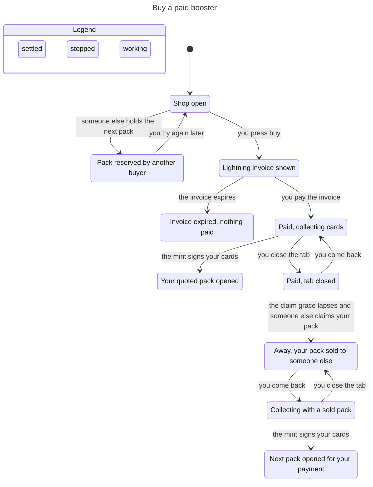

# NutFT verification

Project-local skills under `.claude/skills` check the Pokémon mint (`pokemon/server/nutft-mint.js`) where a bug costs buyers money or duplicates cards:

| Skill | What it checks | Scope |
| --- | --- | --- |
| [verify-nutft-booster-sale](../../.claude/skills/verify-nutft-booster-sale/SKILL.md) | A paid invoice can always collect a pack; one payment buys one pack | 64 states: two buyers, quote, pay, expiry, claim-grace lapse, claim |
| [verify-nutft-card-trade](../../.claude/skills/verify-nutft-card-trade/SKILL.md) | One card proof is replaced at most once | 15 states: two trades of one card and a retry |

The booster model found a bug, now fixed with a regression test (commit 2381605). After a paid invoice's claim grace lapsed, the mint quoted the same pack again but accepted claims only for the pack on sale. Whichever paid buyer claimed second was refused forever.

## Buy a paid booster

Generated with pstack `/statechart` from [BuyBooster.tla](flows/buy-booster/BuyBooster.tla) ([TLC report](flows/buy-booster/report.md)). The chart hides terminal stuttering.

